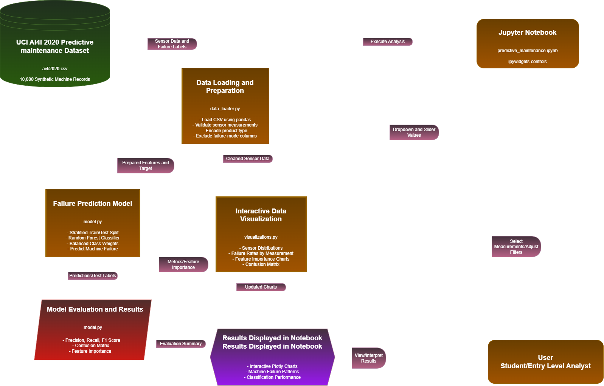

# Predictive Maintenance Intelligence System

For my final project, I plan to create a Python application that explores machine sensor data and attempts to predict machine failures. I will be using the public [UCI AI4I 2020 Predictive Maintenance Dataset](https://archive.ics.uci.edu/dataset/601/ai4i+2020+predictive+maintenance+dataset), which contains 10,000 synthetic machine records. The main goal is to let users explore different measurements, look for potential patterns associated with machine failures, and see how well a machine learning model can predict them. This project is intended for educational purposes and is not intended to be used for real maintenance/safety decisions.

## Technical Description

This section explains how I currently plan to organize and build the project. Some details may change as I work through the course of the project.

### Third Party Libraries and Dependencies

I plan to use a plethora of highly known Python libraries throughout the project. Each one will serve a different purpose, from working with the dataset, to training the model and displaying the results.

| Library / Tool | Purpose in the Project |
| --- | --- |
| **pandas** | Load the CSV dataset, check for missing or invalid values, filter measurements, and organize the data. |
| **NumPy** | Work with numerical data and arrays when preparing and analyzing the machine measurements. |
| **scikit-learn** | Split the data into training and testing sets, train the Random Forest classifier, make predictions, and evaluate the model using precision, recall, F1-score, and a confusion matrix. |
| **Plotly** | Create interactive charts to explore sensor measurements, failure rates, feature importance, and model performance. |
| **ipywidgets** | Add dropdowns and sliders so users can select measurements and change filters in the notebook. |
| **pytest** | Test important parts of the project, including data validation, feature preparation, and model functions. |
| **pdoc** | Generate documentation for the Python modules using their docstrings. |

I plan to use a **Jupyter Notebook** as the main interface for the application. The project will be stored on **GitHub** so I can keep track of the files and any changes I make. I originally intended on using Google Colab, but I have changed my mind.

### Code Structure

I plan to use a **procedural/functional programming approach** for this project. Rather than putting all of the code into one notebook, I want to separate the main parts of the program into smaller Python modules. This should make the code easier to follow, troubleshoot, and test.

I also plan to use a modified **Test Driven Development** approach when building the project. For functions where I already know what the expected results should be, I will try to write tests before implementing them. This will mainly apply to data validation and feature preparation. For the machine learning model and interactive visualizations, I will use a more flexible approach since those parts will require experimentation and adjustments as I go. This will also be good practice for my development skills.

The planned project structure is:

```text
predictive-maintenance-intelligence-system/
├── README.md
├── PredictiveMaintenance.drawio.png
├── predictive_maintenance.ipynb
├── data_loader.py
├── model.py
├── visualizations.py
├── data/
│   └── ai4i2020.csv
├── tests/
│   ├── test_data_loader.py
│   └── test_model.py
└── requirements.txt
```

Most of these files have not been created yet. This is the structure I intend on following as I begin working on the project, although I may make changes if needed.

**Main Notebook (`predictive_maintenance.ipynb`):**

This will be where users interact with the app. The notebook will bring together the different Python modules, run the analysis, and show the results. I also plan on including dropdowns and sliders so users can choose which measurements they want to look at and adjust the charts.

**Data Module (`data_loader.py`):**

This module will handle loading the dataset and getting it ready for analysis. I plan to include the following functions:

- `load_dataset()` - Reads the machine data from the CSV file.
- `validate_data()` - Checks for missing or invalid values, such as negative tool wear or unrecognized product types.
- `prepare_features()` - Separates the failure target from the input features, handles the product type variable, and removes the five failure mode columns (TWF, HDF, PWF, OSF, RNF) from the model inputs to avoid target leakage.

**Model Module (`model.py`):**

This module will focus on training the machine learning model and checking how well it performs. I plan to use a Random Forest classifier from scikit-learn. The main functions will include:

- `train_model()` - Splits the data into training and testing sets while keeping the proportion of failures similar in both sets. It will then train the Random Forest classifier using `class_weight="balanced"` since machine failures are relatively uncommon in the dataset.
- `evaluate_model()` - Evaluates the model using testing data and calculates precision, recall, F1 score, and a confusion matrix.
- `get_feature_importance()` - Finds which measurements had the greatest influence on the model's predictions.

**Visualization Module (`visualizations.py`):**

This module will handle the charts and visualizations. I plan to use Plotly to make the results interactive instead of just displaying static graphs. Users will be able to compare machine measurements, look at failure rates across different ranges, and explore the model's results.

Some of the functions I plan to include are:

- `plot_sensor_distribution()` - Displays the distribution of selected machine measurements.
- `plot_failure_rates()` - Shows how failure rates differ across ranges of sensor measurements.
- `plot_feature_importance()` - Displays which features were most important to the Random Forest model.
- `plot_confusion_matrix()` - Shows how well the model classified machines that failed and those that did not.

**Tests (`tests/`):**

I plan to create unit tests using pytest and follow a modified TDD approach during development. For functions like `validate_data()` and `prepare_features()`, I will write tests first to define how they should handle different inputs. For example, I could write a test that checks whether negative tool wear values are detected or whether the failure mode columns are correctly excluded from the model inputs. After writing these tests, I will implement the functions, run the tests, and make any necessary changes until they pass.

For `model.py`, I will test things like whether the model produces predictions and whether the evaluation functions return the expected metrics. However, I will not require the model to achieve an exact accuracy or F1 score since those results may change as I experiment with the dataset and model settings.

I will also test the visualization functions where possible, but I plan to check the interactive charts manually to make sure they display correctly and respond to user input. Overall, this approach should help me catch problems early without making the development process too restrictive.

**How the Data Flows:**

The process will start when the notebook uses `data_loader.py` to load the UCI dataset. After checking the records and preparing the features, the cleaned data will be passed to `model.py`, where the Random Forest classifier will be trained and evaluated.

The cleaned sensor data and model results will then be used by `visualizations.py` to create the different charts. Through the notebook, users will be able to change dropdowns and sliders to explore the measurements and see updated visualizations. The model will also be tested on data that was not used during training so I can get a better idea of how well it performs on unseen records.

### Architecture Diagram

The diagram below shows how I currently plan for the different parts of the application to work together. It includes the dataset, Python modules, machine learning model, notebook interface, and how users will interact with the results.



# Note:
This diagram was built through the use of (app.diagrams.net)

# AI Disclosure:

AI was used to clean up, explain, and improve upon the README.md file. All other work was done individually.
